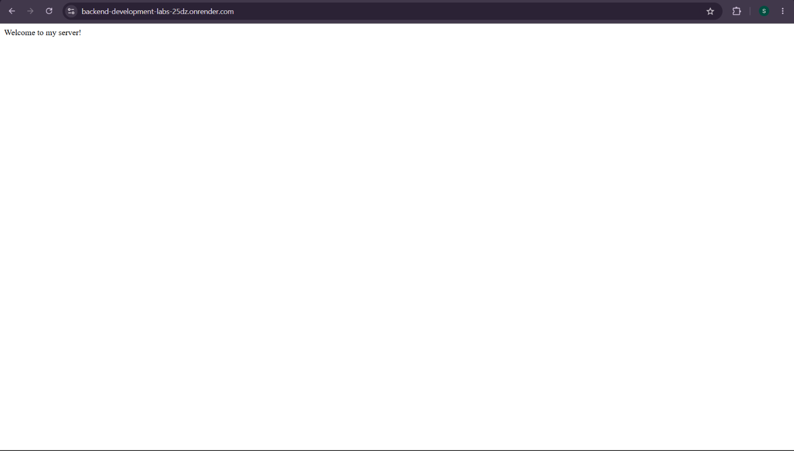
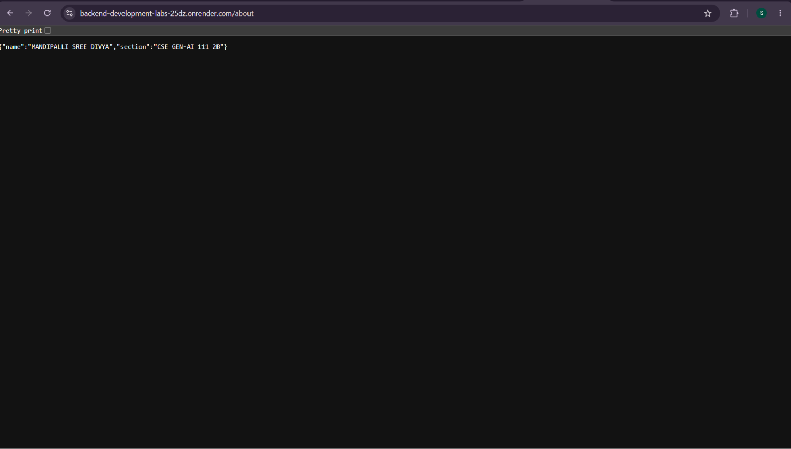
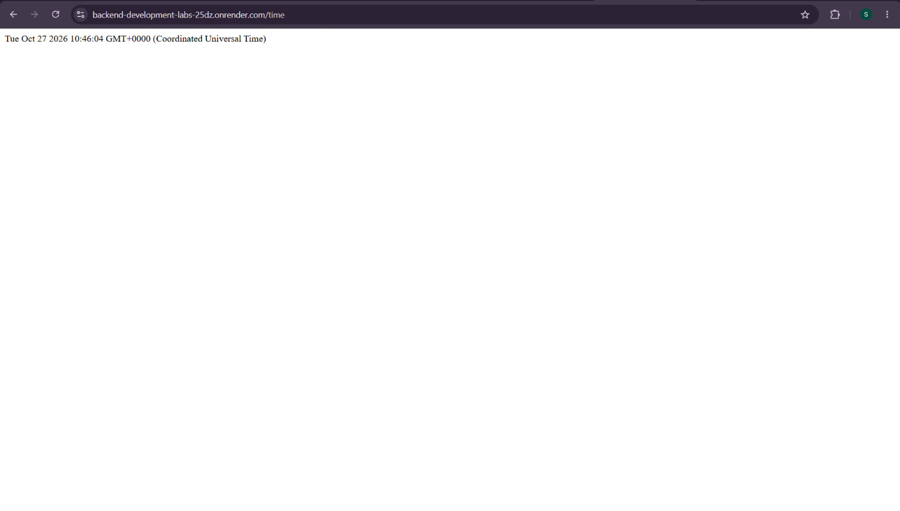
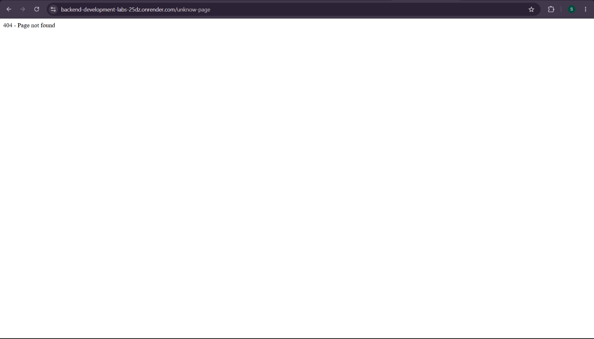

# Lab 1: Node.js and Express Server

## Student Details

- **Name:** MANDIPALLI SREE DIVYA
- **Registration Number:** 252U1R9093
- **Section:** CSE GEN-AI 111 2B
- **Subject:** Backend Development Fundamentals

## Live Link

**Live URL:** https://backend-development-labs-25dz.onrender.com/

## Objective

To set up a Node.js project and build a web server using the built-in HTTP module and Express.js. The server handles different GET routes and returns text, JSON data, the current date and time, and a 404 response for unknown paths.

## Technologies Used

- Node.js
- Express.js
- JavaScript
- npm
- Visual Studio Code
- Git and GitHub

## Project Structure

```text
lab-01/
├── server.js
├── package.json
├── package-lock.json
├── .gitignore
├── README.md
└── screenshots/
    ├── home.png
    ├── about.png
    ├── time.png
    └── not-found.png
```

## Installation and Setup

### Prerequisites

- Node.js installed
- npm installed
- A code editor such as Visual Studio Code

### Step 1: Clone the Repository

```bash
git clone https://github.com/sreedivya7/BACKEND-DEVELOPMENT-LABS.git
```

Navigate to the lab folder:

```bash
cd BACKEND-DEVELOPMENT-LABS/lab-01
```

### Step 2: Initialize the Project

If the project has not been initialized, run:

```bash
npm init -y
```

### Step 3: Install Express

```bash
npm install express
```

### Step 4: Run the Server

```bash
node server.js
```

The server will run on port `3000`.

Open the following URL in your browser:

```text
http://localhost:3000
```

Press `Ctrl + C` in the terminal to stop the server.

## API Endpoints

| Method | Endpoint | Description | Expected Status |
|---|---|---|---|
| GET | `/` | Displays a welcome message. | 200 OK |
| GET | `/about` | Returns student name and section in JSON format. | 200 OK |
| GET | `/time` | Displays the current date and time. | 200 OK |
| GET | Any unknown path | Returns a 404 Not Found message. | 404 Not Found |

## Testing the Endpoints

Start the server and visit each URL in your browser.

### 1. Home Route

URL: `http://localhost:3000/`

Expected output:

```text
Welcome to Node.js and Express Server!
```

### 2. About Route

URL: `http://localhost:3000/about`

Expected output:

```json
{
  "name": "Your Name",
  "section": "Your Section"
}
```

Replace the placeholder values with your actual details.

### 3. Time Route

URL: `http://localhost:3000/time`

Expected output:

```text
Current date and time: [Current date and time]
```

The actual output depends on when the request is made.

### 4. Unknown Route

URL: `http://localhost:3000/unknown`

Expected output:

```text
404 - Page Not Found
```

## Screenshots

Add screenshots of your actual working server responses to the `screenshots/` folder.

### Home Route



### About Route



### Time Route



### 404 Not Found Route



**Note:** Replace the screenshot paths with your actual image filenames if they differ.

## Viva Questions and Answers

**1. What is the difference between `package.json` and `node_modules`?**

`package.json` contains project information, scripts, and dependency details. `node_modules` contains the installed packages used by the project.

**2. What does `app.listen()` do?**

It starts the Express server and makes it listen for incoming requests on the specified port.

**3. What do request and response represent?**

- `req` represents the incoming HTTP request from the client.
- `res` represents the response sent by the server to the client.

**4. What is Node.js?**

Node.js is a JavaScript runtime that allows JavaScript code to execute outside a web browser.

**5. What is Express.js?**

Express.js is a Node.js framework used to build web servers and APIs.

**6. What is a 404 status code?**

It indicates that the requested resource or route was not found.

## Problems Faced and Solutions

- **Problem:** Express module was not found.
  - **Solution:** Installed Express using `npm install express`.
- **Problem:** The server could not start because the port was already in use.
  - **Solution:** Stopped the other process or selected an available port.
- **Problem:** An unknown route did not return a 404 status.
  - **Solution:** Added a 404 handler after the defined routes.

*Update this section to reflect the problems you actually faced.*

## GitHub Submission

Before submitting the project:

1. Ensure all source files and screenshots are included.
2. Add a `.gitignore` file containing:

```gitignore
node_modules/
.env
```

3. Do not commit `node_modules` or any `.env` file.
4. Commit your changes with a meaningful message:

```bash
git add .
git commit -m "Complete Lab 1 Node.js and Express server"
git push
```

5. Submit the GitHub repository link to your faculty.

## Conclusion

Successfully created a Node.js and Express.js server with multiple GET endpoints. Tested the home, about, and time routes, and configured a 404 response for unknown paths.


